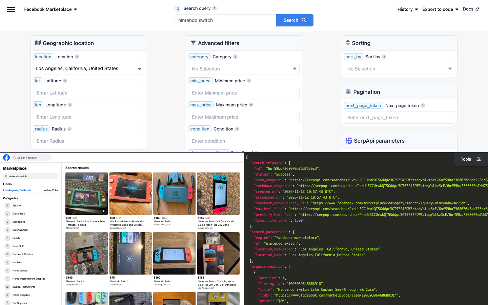

# Facebook Marketplace Scraper

Scrape Facebook Marketplace listings with SerpApi's Facebook Marketplace API. Search the listings around a city or GPS coordinates, by query or category, price, condition, date listed, delivery method, and availability, and get each listing's ID, title, link, price and price before it was lowered, location, date listed, delivery options, category, photo, and seller, plus the mileage of vehicles and the address of rentals.

## How to scrape Facebook Marketplace listings

Search Facebook Marketplace with a simple GET request:

```text
https://serpapi.com/search?engine=facebook_marketplace&q=nintendo+switch&location=Los+Angeles%2C+California%2C+United+States&api_key=SERPAPI_API_KEY
```

- `q` is the search query: anything you'd use in a regular Facebook Marketplace search, e.g., `nintendo switch`, `honda civic`, or `sofa`. It's required unless you set `category`.
- `location` is the place to search around, like the location set on Facebook Marketplace, e.g., `Los Angeles, California, United States` or `London, England, United Kingdom`. A city works best. Instead of `location`, you can set `lat` and `lon`, e.g., `30.2672` and `-97.7431` for Austin. One of them is required.
- `api_key` is your SerpApi API key. Replace `SERPAPI_API_KEY` with it.
- `category` searches a category of the Facebook Marketplace menu, e.g., `electronics`, `vehicles`, or `propertyrentals`. Without `q`, it returns the listings of the category, like its Facebook Marketplace page.
- `min_price`, `max_price`, `condition`, `days_since_listed`, `delivery_method`, and `availability` work like the filters of Facebook Marketplace, e.g., `condition=new,used_like_new`, `days_since_listed=7`, or `availability=sold`.
- `sort_by` sorts the listings by price, date listed, or distance, e.g., `price_ascend`.
- `next_page_token` gets the next pages of results. Each page has up to 24 listings.

A search needs `q` or `category`, and `location` or `lat` and `lon`. Without them, the API returns `400` and "Either `q` or `category` should be specified." or "Either `location` or `lat` and `lon` should be specified.", and with both `location` and `lat` and `lon`, "`location` parameter can't be used together with `lat` and `lon`." Unsupported values return errors such as "Unsupported `furniture` category parameter."

Prices are in the currency of the location, e.g., £135 in London or ¥5,000 in Tokyo, and so are `min_price` and `max_price`. `radius` barely changes the results: with `radius=5`, the Nintendo Switch search around Los Angeles returns the same 24 listings as without it, including one in Irvine, CA, about 55 km away.

[Register at SerpApi](https://serpapi.com?utm_source=github_facebook_marketplace_scraper) to get your API key, and keep it private.

### Playground

Try the request live in the [SerpApi Playground](https://serpapi.com/playground?engine=facebook_marketplace&q=nintendo+switch&location=Los+Angeles%2C+California%2C+United+States&utm_source=github_facebook_marketplace_scraper).

[](https://serpapi.com/playground?engine=facebook_marketplace&q=nintendo+switch&location=Los+Angeles%2C+California%2C+United+States&utm_source=github_facebook_marketplace_scraper)

## Code examples

The code examples read your API key from the `SERPAPI_API_KEY` environment variable:

```bash
export SERPAPI_API_KEY="SERPAPI_API_KEY"
```

Each example searches Facebook Marketplace for a Nintendo Switch around Los Angeles and prints the title, price, and location of each listing.

### curl integration

Send the request with curl, which prints the full JSON response:

```bash
curl --get https://serpapi.com/search \
 --data-urlencode engine="facebook_marketplace" \
 --data-urlencode q="nintendo switch" \
 --data-urlencode location="Los Angeles, California, United States" \
 --data-urlencode api_key="$SERPAPI_API_KEY"
```

### JavaScript integration

Install the [SerpApi JavaScript library](https://github.com/serpapi/serpapi-javascript) and set your project to use ES modules:

```bash
npm install serpapi
npm pkg set type=module
```

Create an `index.js` file:

```javascript
import { getJson } from "serpapi";

const results = await getJson({
  engine: "facebook_marketplace",
  api_key: process.env.SERPAPI_API_KEY,
  q: "nintendo switch",
  location: "Los Angeles, California, United States",
});

for (const listing of results.organic_results ?? []) {
  console.log(listing.title, listing.price, listing.location);
}
```

Run it with `node index.js`.

### Python integration

Install the [SerpApi Python library](https://github.com/serpapi/serpapi-python):

```bash
pip install serpapi
```

Create a `main.py` file:

```python
import os
import serpapi

client = serpapi.Client(api_key=os.getenv("SERPAPI_API_KEY"))
results = client.search({
    "engine": "facebook_marketplace",
    "q": "nintendo switch",
    "location": "Los Angeles, California, United States",
})

for listing in results.get("organic_results", []):
    print(listing["title"], listing.get("price"), listing.get("location"))
```

Run it with `python main.py`.

### Ruby integration

Install the [SerpApi Ruby library](https://github.com/serpapi/serpapi-ruby):

```bash
gem install serpapi
```

Create a `main.rb` file:

```ruby
require "serpapi"

client = SerpApi::Client.new(engine: "facebook_marketplace", api_key: ENV.fetch("SERPAPI_API_KEY"))
results = client.search(q: "nintendo switch", location: "Los Angeles, California, United States")

results.fetch(:organic_results, []).each do |listing|
  puts "#{listing[:title]} #{listing[:price]} #{listing[:location]}"
end

client.close
```

Run it with `ruby main.rb`.

### PHP integration

Install the [SerpApi PHP library](https://github.com/serpapi/serpapi-php):

```bash
composer require serpapi/serpapi-php
```

Create an `index.php` file:

```php
<?php
require 'vendor/autoload.php';

use SerpApi\Client;

$client = new Client(getenv('SERPAPI_API_KEY'), 'facebook_marketplace');
$results = $client->search([
  'q' => 'nintendo switch',
  'location' => 'Los Angeles, California, United States',
]);

foreach ($results->organic_results ?? [] as $listing) {
  echo $listing->title . ' ' . ($listing->price ?? '') . ' ' . ($listing->location ?? '') . PHP_EOL;
}
```

Run it with `php index.php`.

### Go integration

Create a Go module and install the [SerpApi Go library](https://github.com/serpapi/serpapi-golang):

```bash
go mod init example.com/facebook-marketplace
go get github.com/serpapi/serpapi-golang
```

Create a `main.go` file:

```go
package main

import (
	"fmt"
	"os"

	"github.com/serpapi/serpapi-golang"
)

func main() {
	setting := serpapi.NewSerpApiClientSetting(os.Getenv("SERPAPI_API_KEY"))
	setting.Engine = "facebook_marketplace"
	client := serpapi.NewClient(setting)

	results, err := client.Search(map[string]string{
		"q":        "nintendo switch",
		"location": "Los Angeles, California, United States",
	})
	if err != nil {
		panic(err)
	}

	organicResults, _ := results["organic_results"].([]interface{})
	for _, item := range organicResults {
		listing := item.(map[string]interface{})
		fmt.Println(listing["title"], listing["price"], listing["location"])
	}
}
```

Run it with `go run .`.

### Rust integration

Create a Cargo project and add the [SerpApi Rust library](https://github.com/serpapi/serpapi-rust) and Tokio:

```bash
cargo new facebook-marketplace && cd facebook-marketplace
cargo add serpapi tokio --features tokio/full
```

Replace `src/main.rs` with:

```rust
use serpapi::serpapi::Client;
use std::collections::HashMap;
use std::env;

#[tokio::main]
async fn main() -> Result<(), Box<dyn std::error::Error>> {
    let mut default = HashMap::new();
    default.insert("api_key".to_string(), env::var("SERPAPI_API_KEY")?);
    default.insert("engine".to_string(), "facebook_marketplace".to_string());
    let client = Client::new(default)?;

    let mut parameter = HashMap::new();
    parameter.insert("q".to_string(), "nintendo switch".to_string());
    parameter.insert(
        "location".to_string(),
        "Los Angeles, California, United States".to_string(),
    );

    let results = client.search(parameter).await?;
    if let Some(organic_results) = results["organic_results"].as_array() {
        for listing in organic_results {
            println!(
                "{} {} {}",
                listing["title"].as_str().unwrap_or_default(),
                listing["price"].as_str().unwrap_or_default(),
                listing["location"].as_str().unwrap_or_default()
            );
        }
    }
    Ok(())
}
```

Run it with `cargo run`.

### Other programming languages

Official libraries are also available for [Java](https://github.com/serpapi/serpapi-java), [.NET](https://github.com/serpapi/serpapi-dotnet), [Swift](https://github.com/serpapi/serpapi-swift), and [C++](https://github.com/serpapi/serpapi-cpp). See [SerpApi integrations](https://serpapi.com/integrations?utm_source=github_facebook_marketplace_scraper) for setup guides, or use a simple GET request from any programming language.

### Errors

Failed requests return an HTTP error status and a JSON body with an `error` message. The most common are `401` for an invalid API key, `400` for a missing required parameter such as `location`, and `429` when you exceed your hourly throughput limit or run out of searches. See [API status and error codes](https://serpapi.com/api-status-and-error-codes?utm_source=github_facebook_marketplace_scraper) for the full list.

A search without listings, e.g., for `xqzvbnmwplk` around Austin, or with `delivery_method=shipping` outside the United States, still returns `200`, with `search_metadata.status` set to `Success`, `search_information.organic_results_state` set to `Fully empty`, and the error "Facebook Marketplace hasn't returned any results for this query.", so check for `error` before reading `organic_results`. When Facebook Marketplace shows listings of similar searches instead, they're in `relaxed_results`, without an `error`.

## Output formats: JSON and Markdown

Choose structured JSON for applications or Markdown for LLMs and AI agents:

- JSON is the default output and is useful when you need individual result fields.
- Add `output=md` to receive Markdown instead, which is more token-efficient.

Markdown is plain text, not JSON: YAML front matter with the search metadata and parameters, followed by a table of the listings with their ID, title linked to the listing, price, price before it was lowered, location, date listed, delivery types, category ID, video flag, seller, and thumbnail, and a link to the next page. The prices as numbers, in `extracted_price` and `extracted_old_price`, are only in the JSON response. Read the response body as text instead of parsing it.

| Client | Markdown request |
|--------|------------------|
| curl | `--data-urlencode output="md"` |
| Python | `client.search({..., "output": "md"})` |
| PHP | `$client->md([...])` |
| Go | `client.Md(map[string]string{...})` |
| Rust | `client.md(parameter).await?` |

If your SDK doesn't have a Markdown helper yet, send a plain HTTP request with `output=md` and read the body as text. Learn more about [Markdown output](https://serpapi.com/markdown-output?utm_source=github_facebook_marketplace_scraper).

## Facebook Marketplace API parameters

See the [Facebook Marketplace API documentation](https://serpapi.com/facebook-marketplace-api?utm_source=github_facebook_marketplace_scraper) for more details.

| Name | Description | Requirement |
|------|-------------|-------------|
| **Search query** | | |
| `q` | The search query: anything you'd use in a regular Facebook Marketplace search (e.g., `iphone`, `honda civic`, or `sectional sofa`). Without `q`, the search returns the listings of `category`, like its Facebook Marketplace page. | Required, unless `category` is set |
| **Geographic location** | | |
| `location` | The place to search around, like the location set on Facebook Marketplace (e.g., `Los Angeles, California, United States`). A city works best. If several locations match, SerpApi picks the most popular one. Use the [Locations API](https://serpapi.com/locations-api?utm_source=github_facebook_marketplace_scraper) for more precise control. `search_parameters.location_used` shows the location searched. Locations outside the United States work too (e.g., `London, England, United Kingdom` or `Tokyo, Japan`). A state searches around a single place (e.g., `Texas, United States` finds listings around Abilene). Can't be used with `lat` and `lon`. | Required, unless `lat` and `lon` are set |
| `lat` | The GPS latitude of the place to search around (e.g., `30.2672` for Austin). Requires `lon`. Can't be used with `location`. | Required, unless `location` is set |
| `lon` | The GPS longitude of the place to search around (e.g., `-97.7431` for Austin). Requires `lat`. Can't be used with `location`. | Required, unless `location` is set |
| `radius` | The radius of the area to search in, in kilometers (e.g., `16` for 10 miles). Defaults to `65` (40 miles), like on Facebook Marketplace. It barely changes the results: with `radius=5`, the Nintendo Switch search around Los Angeles returns the same 24 listings as without it, including one in Irvine, CA, about 55 km away, and `radius=1` around Marfa, TX returns listings from Alpine, Fort Davis, and Presidio, TX, about 35 to 90 km away. | Optional |
| **Advanced filters** | | |
| `category` | The category to search in, like the categories of the Facebook Marketplace menu: `apparel` (Apparel), `classifieds` (Classifieds), `electronics` (Electronics), `entertainment` (Entertainment), `family` (Family), `free` (Free Stuff), `garden` (Garden & Outdoor), `hobbies` (Hobbies), `home` (Home Goods), `home-improvements` (Home Improvement Supplies), `instruments` (Musical Instruments), `office-supplies` (Office Supplies), `pets` (Pet Supplies), `propertyrentals` (Property Rentals), `sports` (Sporting Goods), `toys` (Toys & Games), or `vehicles` (Vehicles). It's the name used in the URL of the category's Facebook Marketplace page. `home-improvements` and `office-supplies` can't be used with `q`. | Required, unless `q` is set |
| `min_price` | The minimum price, as a whole number in the currency of the listings (e.g., `100`, i.e., £100 in London). Can't be greater than `max_price`. | Optional |
| `max_price` | The maximum price, as a whole number in the currency of the listings (e.g., `500`). | Optional |
| `condition` | The conditions of the items, as a comma-separated list (e.g., `new,used_like_new`): `new` (New), `used_like_new` (Used - Like new), `used_good` (Used - Good), or `used_fair` (Used - Fair). Defaults to any condition. | Optional |
| `days_since_listed` | How recently the items were listed: `1` (Last 24 hours), `7` (Last 7 days), or `30` (Last 30 days). Defaults to any date. `1` can include slightly older listings: 7 of 24 Nintendo Switch listings around Los Angeles were listed 24 to 35 hours before the search. | Optional |
| `delivery_method` | How the items can be delivered: `local_pick_up` (Local pickup) or `shipping` (Shipping). Defaults to both. Like on Facebook Marketplace, shipping is only available in the United States, so outside it, `shipping` returns no listings. With `shipping`, the listings come from the whole country (e.g., Washington, MI and Frisco, TX for a search around Los Angeles). | Optional |
| `availability` | Set to `available` (default) for the items for sale, or `sold` for the items already sold, which also include items with a pending sale. | Optional |
| **Sorting** | | |
| `sort_by` | The order of the listings: `best_match` (Suggested, default), `distance_ascend` (Distance: Nearest first), `creation_time_descend` (Date listed: Newest first), `price_ascend` (Price: Lowest first), or `price_descend` (Price: Highest first). `price_ascend` starts with the listings priced Free. Sorting by distance or date can return pages with few listings (e.g., 2 bikes on the first page around Austin sorted by date, and 11 on the second). `distance_ascend` with `category=electronics` around Austin returned listings from the San Francisco Bay Area, and `creation_time_descend` doesn't always start with the newest listings, so use `days_since_listed` to get recent listings. | Optional |
| **Pagination** | | |
| `next_page_token` | The token of the next page, from `serpapi_pagination.next_page_token`. Each page has up to 24 listings. Pages can repeat listings from earlier pages, so deduplicate them by `listing_id`. | Optional |
| **SerpApi parameters** | | |
| `engine` | Set to `facebook_marketplace`. | Required |
| `api_key` | Your private SerpApi API key. | Required |
| `no_cache` | Set to `true` to request fresh results instead of using the one-hour cache. Can't be combined with `async`. | Optional |
| `async` | Set to `true` for later retrieval through the [Searches Archive API](https://serpapi.com/search-archive-api?utm_source=github_facebook_marketplace_scraper). Can't be combined with `no_cache` or used with Ludicrous Speed enabled. | Optional |
| `zero_trace` | Enterprise only. Set to `true` to skip storing search parameters, files, and metadata on SerpApi servers. | Optional |
| `output` | Set to `json` (default), `html` for the raw JSON retrieved from Facebook Marketplace, or `md` for Markdown. | Optional |
| `json_restrictor` | Limit the JSON response to the fields you need. See the [JSON Restrictor](https://serpapi.com/json-restrictor?utm_source=github_facebook_marketplace_scraper) documentation. | Optional |

## Available data on Facebook Marketplace listings (JSON response)

Each item in `organic_results` is a listing on Facebook Marketplace around `location`, with its title, price, location, date listed, delivery options, category, photo, and seller. For a search without matching listings, Facebook Marketplace can show listings of similar searches instead, in `relaxed_results`. The field guides below describe the possible fields and their types; they aren't literal API responses.

### What you get depends on the listing and the search

Some fields appear only for some listings or searches:

| Listing or search | Fields |
|-------------------|--------|
| A vehicle, e.g., for `honda civic` or with `category=vehicles` | `name` with the vehicle's own title, e.g., 2001 Honda Civic · LX Sedan 4D for the title 2001 Honda civic, and `details` with its mileage, e.g., 90K miles. Some vehicles have no `name`. |
| A property rental, with `category=propertyrentals` | `details` with the city, e.g., Chicago, IL, and for some rentals the street address before it |
| A listing with a lowered price | `old_price` and `extracted_old_price` with the price before it was lowered, e.g., $150 for a Nintendo Switch Lite now at $80 |
| A listing with a video | `has_video` set to `true` |
| A search with `availability=sold` | `is_sold` set to `true` on sold items, or `is_pending` set to `true` on items with a pending sale |
| A listing that can be shipped, e.g., with `delivery_method=shipping` | `shipping_onsite` or `shipping_offsite` in `delivery_types`, e.g., `shipping_offsite` for an e-bike at €1,650 in Berlin |
| A search without matching listings nearby, e.g., `tuba` around Austin with `days_since_listed=1` | `relaxed_results` instead of `organic_results`, e.g., a Vintage Lead Toy Soldier Marching Band Set at $40 in Arlington, TX |
| A location outside the United States | Prices in the local currency, e.g., £135, €85, CA$150, A$70, or ¥5,000, and locations in the local form, e.g., Berlin, BE, Sydney, NSW, or 渋谷区, 東京都 in Tokyo |

Each listing has a `listing_id` and a `link` to its page on Facebook Marketplace. Prices are returned as displayed, e.g., $2,500 or Free, and as integers in the matching `extracted_` fields, e.g., 2500 or 0. `listed_at` is in UTC, and `category_id` is Facebook Marketplace's ID of the listing's category, e.g., 686977074745292 for the Nintendo Switch listings and 807311116002614 for vehicles.

To get the next page, set `next_page_token` to `serpapi_pagination.next_page_token`, or follow `serpapi_pagination.next`. `position` restarts at 1 on each page, and pages can repeat listings: the second and third pages of the Nintendo Switch search each repeat 2 listings of the first page, so deduplicate them by `listing_id`. When the nearby listings run out, the next pages have listings from farther away, e.g., San Antonio, TX on the second page of a bike search around Marfa, TX.

### Organic results

Each listing in `organic_results` can include these fields:

```json
{
  "organic_results": [
    {
      "position": "Integer - Position of the listing on the page, starting at 1 on each page",
      "listing_id": "String - Facebook Marketplace ID of the listing",
      "title": "String - Title of the listing, as shown on Facebook Marketplace, e.g., Nintendo Switch Lite Custom See-Through +& Case",
      "name": "String - Own title of a vehicle, which Facebook Marketplace shows with another title, e.g., 2001 Honda Civic · LX Sedan 4D",
      "link": "String - Link to the listing on Facebook Marketplace, in the form https://www.facebook.com/marketplace/item/<listing_id>/",
      "price": "String - Price, as displayed, e.g., $80, £135, or Free",
      "extracted_price": "Integer - Price as a number, e.g., 80, or 0 for Free",
      "old_price": "String - Price before it was lowered, as displayed, e.g., $150",
      "extracted_old_price": "Integer - Price before it was lowered as a number, e.g., 150",
      "location": "String - City where the item is, e.g., Monrovia, CA",
      "details": "Array[String] - Mileage of a vehicle or address of a rental, e.g., 90K miles or Chicago, IL",
      "listed_at": "String - Date and time the item was listed, in ISO 8601 format, e.g., 2026-10-29T19:38:59Z",
      "delivery_types": "Array[String] - How the item can be delivered: in_person, public_meetup, door_pickup, door_dropoff, shipping_onsite, or shipping_offsite",
      "category_id": "String - Facebook Marketplace ID of the category of the listing, e.g., 686977074745292",
      "is_sold": "Boolean - true if the item is sold, with availability set to sold",
      "is_pending": "Boolean - true if the sale of the item is pending, with availability set to sold",
      "has_video": "Boolean - true if the listing has a video",
      "seller": {
        "name": "String - Name of the seller",
        "id": "String - Facebook ID of the seller"
      },
      "thumbnail": "String - Link to the main photo of the listing"
    }
  ]
}
```

Most sellers have an obfuscated `seller.id` starting with pfbid, which changes over time, instead of a numeric ID.

### Relaxed results, search information, and pagination

`relaxed_results` has the listings Facebook Marketplace shows for a search without matching listings, `search_information` describes a search without any listings, and `serpapi_pagination` links to the next page:

```json
{
  "relaxed_results": "Array[Object] - Listings of similar searches and from farther away, with the same fields as in organic_results",
  "search_information": {
    "organic_results_state": "String - Fully empty when the search has no listings"
  },
  "serpapi_pagination": {
    "next_page_token": "String - Token of the next page, for the next_page_token parameter",
    "next": "String - SerpApi link to the next page"
  }
}
```

`search_information` only appears on searches without listings, together with an `error` message.

## AI agents and no-code

### MCP

Give AI agents and assistants a Facebook Marketplace listing search tool with the hosted [SerpApi MCP server](https://github.com/serpapi/serpapi-mcp) at `https://mcp.serpapi.com/mcp`.

Claude Code:

```bash
claude mcp add --transport http serpapi https://mcp.serpapi.com/mcp --header "Authorization: Bearer $SERPAPI_API_KEY"
```

Codex, which reads the key from `SERPAPI_API_KEY`:

```bash
codex mcp add serpapi --url https://mcp.serpapi.com/mcp --bearer-token-env-var SERPAPI_API_KEY
```

Other MCP clients:

```json
{
  "mcpServers": {
    "serpapi": {
      "type": "http",
      "url": "https://mcp.serpapi.com/SERPAPI_API_KEY/mcp"
    }
  }
}
```

The server's engine catalog includes the `facebook_marketplace` engine, and its `serpapi://engines/facebook_marketplace` resource describes the parameters. Ask your agent to search Facebook Marketplace with the `facebook_marketplace` engine and a `location`. The resulting tool call looks like this:

```json
{
  "name": "search",
  "arguments": {
    "params": {
      "engine": "facebook_marketplace",
      "q": "nintendo switch",
      "location": "Los Angeles, California, United States"
    }
  }
}
```

See the [MCP integration guide](https://serpapi.com/integrations/mcp?utm_source=github_facebook_marketplace_scraper) for more clients and self-hosting.

### CLI

Search Facebook Marketplace from your terminal or from AI agent workflows with the [SerpApi CLI](https://github.com/serpapi/serpapi-cli):

```bash
brew tap serpapi/homebrew-tap
brew install serpapi-cli
```

The CLI picks up `SERPAPI_API_KEY` from your environment. You can also run `serpapi login` to save a key.

```bash
serpapi search engine=facebook_marketplace q="nintendo switch" location="Los Angeles, California, United States"
serpapi search engine=facebook_marketplace q="nintendo switch" location="Los Angeles, California, United States" --fields "organic_results[].{title, price, location, listed_at, link}"
serpapi search engine=facebook_marketplace q="nintendo switch" location="Los Angeles, California, United States" output=md
```

### No-code tools

Use SerpApi APIs without writing code:

- [NoCodeSerpApi](https://nocodeserpapi.com/)
- [SerpApi with n8n](https://serpapi.com/blog/tag/n8n/)
- [SerpApi with Make](https://serpapi.com/blog/tag/make/)
- [More integrations](https://github.com/serpapi/serpapi-integrations/)

## Use cases

- Research the going prices of used items in a city, e.g., game consoles, bikes, or sofas, by condition and price range.
- Estimate the resale value of products from the prices of sold items with `availability=sold`.
- Compare used car prices and mileage across cities with `category=vehicles`.
- Monitor the market for a product: new listings with `days_since_listed`, and price drops with `old_price`.
- Compare rental prices across cities with `category=propertyrentals`.
- Give AI agents and shopping assistants a secondhand marketplace search tool.

## Related scrapers

- [Facebook Profile Scraper](https://github.com/serpapi/facebook-profile-scraper): public Facebook profiles and pages
- [Google Shopping Scraper](https://github.com/serpapi/google-shopping-scraper): products and prices from Google Shopping
- [Amazon Scraper](https://github.com/serpapi/amazon-scraper): Amazon search results

## Contact

Feel free to reach out at [contact@serpapi.com](mailto:contact@serpapi.com).
